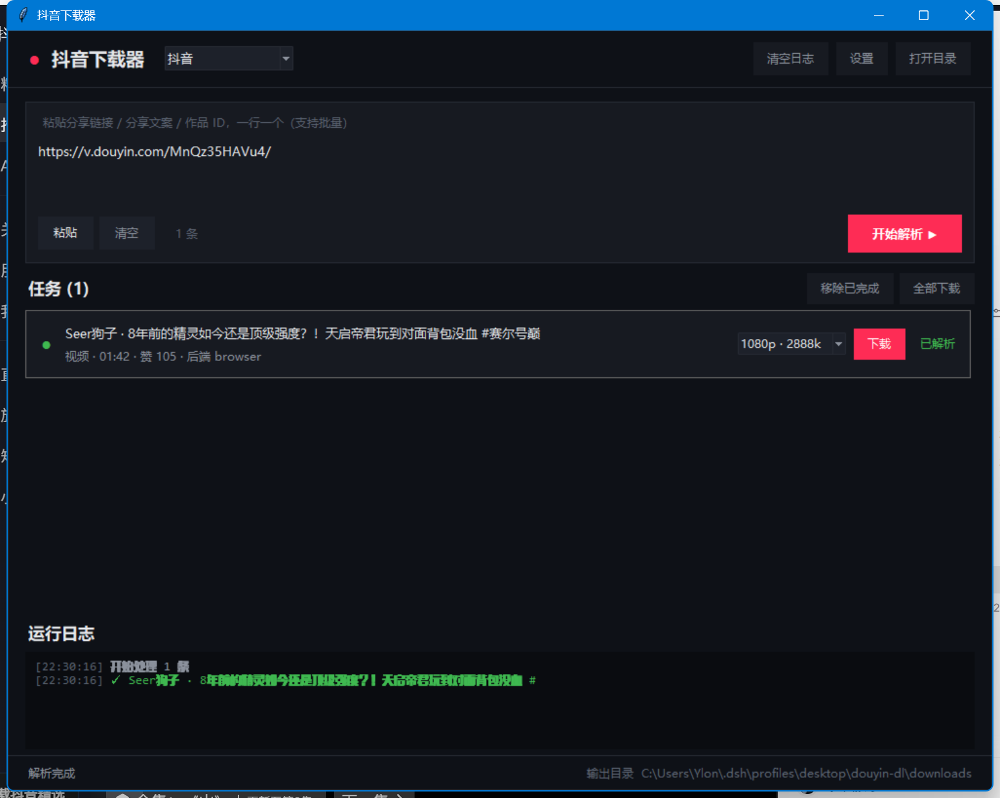

# douyin-dl

抖音无水印解析下载工具。**不需要逆向签名算法** —— 让浏览器自己算。

---

## 为什么这么设计

抖音 2024 年后把三个纯 HTTP 入口全封了，实测结果：

| 入口 | 结果 |
|---|---|
| `iesdouyin.com/share/video/{id}/` SSR | 200 但数据被剥离，`_ROUTER_DATA` 只剩空壳 |
| `/aweme/v1/web/aweme/detail/` | `403 Blocked by ArgusSecurityPlugin Uifid Not Found` |
| `/web/api/v2/aweme/iteminfo/` | 200 但返回空 body，接口已废弃 |

硬闯 detail 接口需要同时具备：

- `a_bogus` —— 184 字符签名（RC4 + 自定义 base64 + 浏览器指纹），平均每季度变一次
- `x-secsdk-web-signature` —— secsdk 二次签名
- `uifid` —— 作为 **URL 查询参数**（不是 cookie）传递
- `fp` / `verifyFp` / `timestamp` —— 设备指纹

实测：把浏览器导出的 29 个 cookie 全灌进 requests，仍然 403。
**所以放弃移植签名算法。**

本项目的做法：**起一个真浏览器，在页面上下文里 `fetch` detail 接口**。
页面自己的 SDK 会算出合法签名，我们只截取返回的 JSON。

这样做的好处：

- 抖音改签名算法 → 完全不受影响
- 抖音加新校验字段 → 完全不受影响
- 唯一依赖是「页面里的 fetch 能跑通」，而这正是用户能播就能下的前提

代价是首次要启动浏览器（约 8 秒）。用两层优化摊薄：

1. **会话复用** —— 一个 `DouyinParser` 实例内浏览器只起一次，之后每次 fetch 约 1 秒
2. **结果缓存** —— 同一个作品 1 小时内重复解析直接读磁盘（0.99 秒实测）

---

## 安装

```bash
# 1. 装依赖
pip install -r requirements.txt

# 2. 装浏览器（如果用系统 Chrome 可跳过）
python -m playwright install chromium
```

需要 Python 3.10+。系统有 Chrome 或 Edge 时优先用系统浏览器，无需下载 chromium。

---

## 给 AI Agent 调用

项目自带一个标准 Skill，放在 [`skill/`](skill/)：

```
skill/
├── SKILL.md          ← agent 读这个
├── reference.md      ← 深度参考（原理/字段/扩展）
└── scripts/
    ├── agent_dl.py   ← 主入口，stdout 纯 JSON
    └── check_env.py  ← 环境自检
```

把它放到你的 agent 的 skills 目录，或者直接照着 `SKILL.md` 调脚本。

### 一行调用

```bash
python skill/scripts/agent_dl.py "https://v.douyin.com/xxxxx/" --json
```

**stdout 只有一个 JSON 对象，日志全部走 stderr** —— 可以直接 `json.loads`，不会被进度条污染。

```json
{
  "ok": true,
  "summary": {"total": 1, "succeeded": 1, "failed": 0, "bytes": 1405018523,
              "elapsed_s": 42.1, "out_dir": "C:\\...\\downloads"},
  "results": [{
    "ok": true,
    "aweme_id": "7679426956026187035",
    "title": "一个人，18个月2万元手搓94分钟刘慈欣AI仿真人科幻电影",
    "author": "野生锅",
    "duration": "45:30",
    "quality": "1080p",
    "files": [{"path": "C:\\...\\xxx_1080p.mp4", "name": "xxx_1080p.mp4",
               "size": 1405018523, "kind": "mp4"}],
    "total_bytes": 1405018523,
    "large": true
  }]
}
```

拿 `results[i].files[0].path` 就能直接发送/上传。

### 典型场景：用户远程发链接，下载好再发回去

```
1. python skill/scripts/agent_dl.py "<链接>" --json
2. 读 results[0].files[0].path 和 total_bytes
3. 用宿主自己的能力把文件发回给用户
```

`large: true` 表示 ≥100MB，先报大小或加 `--quality 720p` 降档再下。

想先确认再下载（长视频动辄上 G）：

```bash
python skill/scripts/agent_dl.py "<链接>" --json --no-download   # 只解析
python skill/scripts/agent_dl.py "<链接>" --json --quality 720p  # 确认后下
```

### 出错时

```json
{"ok": false, "code": "PARSE_FAILED", "error": "作品不可访问（已删除 / 私密）[core_dep]",
 "hint": "解析失败（作品不可访问 / 风控 / 网络）"}
```

错误码：`NO_ID` / `UNSUPPORTED` / `PARSE_FAILED` / `NO_MEDIA` / `DOWNLOAD_FAILED`
（完整处理建议见 [SKILL.md](skill/SKILL.md)）

### 环境自检

```bash
python skill/scripts/check_env.py --json
```

返回依赖、浏览器、ffmpeg、登录态、网络连通性，`ready: false` 时 `issues` 里写明缺什么。

---

## 图形界面（推荐人手用）

双击 **`start.bat`** 即可。不需要装任何 GUI 库（Tkinter 是标准库）。



界面布局：

```
┌────────────────────────────────────────────────────────────┐
│ ● 抖音下载器   [平台 ▾]        [清空日志] [设置] [打开目录] │
├────────────────────────────────────────────────────────────┤
│  粘贴分享链接 / 分享文案 / 作品 ID，一行一个（支持批量）    │
│  ┌──────────────────────────────────────────────────────┐  │
│  │ https://v.douyin.com/xxxxx/                          │  │
│  └──────────────────────────────────────────────────────┘  │
│  [粘贴] [清空]  1 条                    [开始解析 ▶]        │
├────────────────────────────────────────────────────────────┤
│  任务 (1)                          [移除已完成] [全部下载]  │
│  ✓ Seer狗子 · 8年前的精灵...      [1080p·2888k ▾][已下载] │
│    视频 · 01:42 · 赞 105 · 后端 browser          已完成     │
│    ████████████████████████████  100% 35.3MB 2.1MB/s  完成  │
├────────────────────────────────────────────────────────────┤
│  运行日志                              当前步骤：请求详情…  │
│  [22:29:12] 开始处理 1 条                                   │
│  [22:29:12] ✓ 作品 ID: 7700973189773479183                  │
│  [22:29:20] ✓ 接口返回 200，开始解析数据                    │
│  [22:29:35] ✓ 完成 ... · 35.3MB · 1 文件                    │
└────────────────────────────────────────────────────────────┘
 解析完成              输出目录 D:\...\douyin-dl\downloads
```

**每一步都可视化**：

| 阶段 | 在哪看 |
|---|---|
| 识别链接 / 展开短链 | 任务卡片副标题 + 日志 |
| 启动浏览器 / 会话就绪 | 日志 `✓ 浏览器会话就绪` |
| 请求接口 / 返回码 | 日志 `✓ 接口返回 200` |
| 解析出的档位 | 清晰度下拉框（1080p · 2888k / 720p · 2078k / 540p · 1811k） |
| 下载进度 / 速度 | 卡片内进度条 + `35.3MB 2.1MB/s` |
| 失败原因 | 卡片变红 + 具体错误文本 |

其它功能：

- **批量**：输入框一行一个链接，一次全解析
- **清晰度选择**：每个任务独立选档，不选默认最高清
- **全部下载**：一键提交所有已解析任务
- **设置**：改输出目录、限速
- **打开目录**：直接跳到下载好的文件

### 下载控制

每个任务卡片右边有三个按钮，形态随状态变化：

| 状态 | 主按钮 | 取消按钮 | 说明 |
|---|---|---|---|
| 已解析 | 下载 | 隐藏 | |
| 下载中 | 暂停 | 显示 | 暂停后状态变黄 `‖ 已暂停` |
| 已暂停 | 继续 | 显示 | 从断点续传，不重下 |
| 已完成 | 打开 | 隐藏 | 直接跳到文件 |
| 失败 | 重试 | 隐藏 | |
| 已取消 | 重新下载 | 隐藏 | `.part` 保留，再点会续传 |

最右边的 `✕` 是删除任务。若有已下载文件，会问一句：

```
是   = 删文件并移除任务
否   = 只移除任务（文件保留）
取消 = 什么都不做
```

暂停/取消都作用在真实的网络流上（不是界面假动作）：暂停后进度条字节数确实停住，继续时按 `Range` 从断点续传。

### 下载历史

点顶栏 **历史** 打开。记录保存在 `~/.douyin_dl/history.json`，重启后还在。

| 列 | 说明 |
|---|---|
| 时间 | 下载完成时间 |
| 标题 / 作者 | |
| 类型 | 视频 / 图集 |
| 清晰度 | 当时选的档位 |
| 大小 | 落盘总字节 |
| 文件 | `✓ 在` 文件还在 / `✗ 丢失` 被手动删了 |

双击记录直接打开文件。底部按钮：打开文件 / 在目录中显示 / 移除记录 / 清空历史。

清空历史时会问要不要连文件一起删。

### 限速

设置里可以填 `MB/s`，`0` 为不限。适合边下边干别的，或者怕占满带宽被平台风控。

> 早先的 `下载.bat` 双击闪退，是因为 cmd 按 GBK 读 UTF-8 脚本导致中文行解析失败。
> 现在 `start.bat` 是纯 ASCII，只负责启动 GUI，不会再有问题。

---

## 命令行用法

```bash
# 解析，只看信息不下载
python -m douyin_dl parse "https://v.douyin.com/xxxxx/"

# 解析并输出 JSON
python -m douyin_dl parse "https://v.douyin.com/xxxxx/" --json

# 下载
python -m douyin_dl dl "https://v.douyin.com/xxxxx/" -o D:\videos

# 同时下背景音乐
python -m douyin_dl dl "https://v.douyin.com/xxxxx/" --music

# 图集额外打包 zip
python -m douyin_dl dl "https://v.douyin.com/xxxxx/" --zip

# 批量：从文本文件读链接（一行一个，# 开头是注释）
python -m douyin_dl dl --file urls.txt -o D:\videos

# 直接给作品 ID 也行
python -m douyin_dl dl 7700973189773479183

# 首次扫码登录（想要更高清晰度 / 看受限内容）
python -m douyin_dl dl "链接" --headed --profile .\chrome-profile
```

装成命令后可以直接 `douyin`：

```bash
pip install -e .
douyin parse "https://v.douyin.com/xxxxx/"
```

### 输入格式

以下全部接受，不用自己抠 ID：

- 完整分享文案（含「复制此链接，打开抖音搜索」那串）
- `https://v.douyin.com/xxxxx/` 短链
- `https://www.douyin.com/video/7300000000000000000`
- `https://www.douyin.com/discover?modal_id=...`
- `https://www.iesdouyin.com/share/video/...`
- 纯数字作品 ID

---

## Python API

```python
from douyin_dl import DouyinParser, Downloader

# 上下文管理器会自动关浏览器
with DouyinParser() as p:
    aweme = p.parse("https://v.douyin.com/xxxxx/")

    print(aweme.desc)
    print(aweme.author_name, aweme.duration_text)
    print(aweme.video.url)        # 无水印直链
    print(aweme.video.quality)    # 1080p
    print(aweme.music.url)        # 背景音乐

    # 所有清晰度档位都在 raw 里
    for br in aweme.raw["video"]["bit_rate"]:
        print(br["gear_name"], br["bit_rate"])

    # 下载
    files = Downloader("downloads").save(aweme)
```

### 批量解析（浏览器只起一次）

```python
from douyin_dl import DouyinParser, Downloader
from pathlib import Path

urls = [ln.strip() for ln in Path("urls.txt").read_text(encoding="utf-8").splitlines() if ln.strip()]

with DouyinParser() as p:                      # 浏览器起一次
    dl = Downloader("downloads")
    for u in urls:
        try:
            aweme = p.parse(u)                 # 之后每次约 1 秒
            dl.save(aweme)
            print("OK", aweme.aweme_id)
        except Exception as e:
            print("FAIL", u, e)
```

### 主要参数

| 参数 | 说明 |
|---|---|
| `headless=True` | 无头模式，默认 |
| `user_data_dir="..."` | 持久化 profile，保存登录态 |
| `use_cache=True` | 启用 detail 结果缓存 |
| `cache_ttl=3600` | 缓存有效期（秒） |
| `prefer="browser"` | 指定后端 |
| `proxy="http://127.0.0.1:7890"` | 走代理 |

---

## 数据结构

```python
Aweme
├── aweme_id: str
├── desc: str                    # 标题
├── author_name / author_id / author_avatar
├── cover: str
├── duration_ms: int
├── medias: list[Media]          # 视频 1 条 / 图集 N 条
├── music: Media | None
├── statistics: dict             # digg / comment / share / collect / play
├── backend: str                 # 命中的后端，排错用
└── raw: dict                    # 原始 JSON，字段全在里面

Media
├── kind: str                    # video / image / audio
├── url: str
├── quality: str                 # 1080p / 720p ...
├── ext: str                     # mp4 / jpg / mp3
└── index: int
```

`aweme.is_image_post` 判断图文，`aweme.images` 拿图片列表，`aweme.video` 拿视频。

---

## 常见问题

**Q: 提示 `Unable to launch browser`**
装 Chrome，或跑 `python -m playwright install chromium`。

**Q: 解析返回 `作品不可访问 [core_dep]`**
这是抖音的内容级过滤，不是风控。ID 可能已删除、私密，或者那条 `/shipin/` 链接给的是合集 ID 不是作品 ID。

**Q: 一直走浏览器，能不能纯 HTTP 快一点？**
不能，除非自己实现 a_bogus。上面「为什么这么设计」有实测结论。
实际使用中批量场景摊薄后平均成本很低，配合缓存单条 1 秒内。

**Q: 能拿到更高清晰度吗？**
不用登录已经能拿 1080p（14 档全在 `raw["video"]["bit_rate"]` 里）。
想要更高或受限内容，登录一次：

```bash
python tools/login.py            # 弹出窗口扫码，登录态存进 ./chrome-profile
python -m douyin_dl dl "链接" --profile .\chrome-profile
```

Windows 上也可以直接双击 `登录一次.bat`。

**Q: 能不能直接接管我正在用的 Chrome？**
Chrome 136+ 出于安全限制，`--remote-debugging-port` 配默认 profile 会被忽略，
必须指定独立的 `--user-data-dir`，那还是要重新登录一次。
所以别折腾 CDP，用 `--profile` 更省事。（`--cdp` 参数保留着，你有独立调试端口的 Chrome 时可用。）

**Q: 进度条是真的吗？**
真的，按 `Content-Length` 和实际写入字节逐块算。

这里踩过一个坑：tqdm 在 `disable=True` 时 `update()` 直接 return，`bar.n` 永远是 0。早期版本用 `bar.n` 当进度源，导致 GUI 进度条只有 0% 和 100% 两态 —— 看起来像假的。现在自己维护 `written` 计数器，与 tqdm 解耦。

**Q: 暂停了会不会白下？**
不会。暂停只是停住网络流，已写入的 `.part` 保留。继续时带 `Range` 请求头从断点拉。取消同理，再点「重新下载」也是续传。

**Q: 历史文件在哪？**
`~/.douyin_dl/history.json`。纯 JSON，可以直接改或导进别的地方。最多保留 2000 条，超了自动淘汰最旧的。

**Q: 会不会被封？**
单条请求走浏览器正常节奏，不并发轰炸就不会。批量时加 `Downloader(workers=4)` 是下文件不是打接口，安全。
真要大量跑，`proxy=` 换出口 IP。

**Q: 换了电脑还能用吗？**
整个目录拷过去，`pip install -r requirements.txt` 即可。缓存目录在 `~/.douyin_dl/`，删了不影响。

---

## 项目结构

```
douyin-dl/
├── start.bat                 双击启动 GUI（纯 ASCII，不会闪退）
├── gui.py                   Tkinter 图形界面
├── config.example.toml      配置样例，复制成 config.toml 生效
├── skill/                   ★ AI Agent 入口
│   ├── SKILL.md             调用契约、错误码、结果处理
│   ├── reference.md         原理 / 字段 / 扩展深度参考
│   └── scripts/
│       ├── agent_dl.py      主入口，stdout 纯 JSON
│       └── check_env.py     环境自检
├── douyin_dl/
│   ├── platforms.py         平台注册表 ← 加新平台从这里开始
│   ├── config.py            配置加载（CLI > ENV > toml > 默认）
│   ├── agent.py             Agent 层，结构化输出
│   ├── envcheck.py          环境自检实现
│   ├── session.py           浏览器会话（免签名核心）
│   ├── parser.py            抖音解析，多后端降级 + 缓存
│   ├── resolver.py          链接处理（短链展开、ID 提取）
│   ├── models.py            数据结构（与平台解耦）
│   ├── downloader.py        下载器（续传/暂停/取消/限速）
│   ├── history.py           下载历史
│   └── cli.py               命令行
├── tools/login.py           一次性扫码登录
├── examples/batch.py        批量示例
├── tests/                   自测和探测脚本
├── requirements.txt
└── pyproject.toml
```

### 命令行子命令

| 命令 | 用途 |
|---|---|
| `python -m douyin_dl agent ...` | Agent 入口，JSON 输出 |
| `python -m douyin_dl envcheck` | 环境自检 |
| `python -m douyin_dl config` | 查看生效配置 / `--sample` 打样例 |
| `python -m douyin_dl parse` | 只解析不下载 |
| `python -m douyin_dl dl` | 解析并下载 |
| `python -m douyin_dl from-json` | 按 `parse --json` 的结果下载 |

---

## 配置

优先级：**命令行参数 > 环境变量 > `config.toml` > 内置默认值**

```bash
cp config.example.toml config.toml   # 然后按需改
```

环境变量用双下划线表示层级：

```bash
DOUYIN_DL_DOWNLOAD__OUT_DIR=D:\videos
DOUYIN_DL_BROWSER__HEADLESS=0
DOUYIN_DL_DOWNLOAD__QUALITY=720p
```

查看当前生效配置：

```bash
python -m douyin_dl config
```

---

## 扩展新平台

整个工程已经为多平台留好位置。`douyin_dl/platforms.py` 是唯一入口：

```python
PLATFORMS = {
    "douyin":       Platform(..., ready=True),   # 已实现
    "xiaohongshu":  Platform(..., ready=False),  # 显示「即将支持」
    "bilibili":     Platform(..., ready=False),
    "kuaishou":     Platform(..., ready=False),
    "youtube":      Platform(..., ready=False),
    "weibo":        Platform(..., ready=False),
}
```

GUI 的下拉框、CLI、平台识别全部从这里读，**不写死**。
新增一个平台只需三步：

**1. 写 Parser**

```python
# douyin_dl/xhs.py
from .models import Aweme, Media

class XhsParser:
    def parse(self, text: str) -> Aweme:
        # 拿数据...
        return Aweme(
            aweme_id=note_id,
            desc=title,
            author_name=nickname,
            medias=[Media(kind="video", url=url, quality="1080p", ext="mp4")],
        )

    def close(self) -> None:
        pass
```

**2. 登记**

```python
# platforms.py
def _xhs_factory(**kw):
    from .xhs import XhsParser
    return XhsParser(**kw)

"xiaohongshu": Platform(
    key="xiaohongshu", name="小红书",
    accent="#FF2442", ready=True,          # ← 改成 True
    link_patterns=["xhslink.com", "xiaohongshu.com"],
    factory=_xhs_factory,                   # ← 加 factory
),
```

**3. 完事**

GUI 下拉框自动可用，`Downloader` 直接复用（断点续传、并发、图集打包全都现成）。

各平台难度参考：

| 平台 | 难度 | 要点 |
|---|---|---|
| B站 | ★☆☆ | 公开接口 + Referer，走纯 requests 即可 |
| 微博 | ★☆☆ | `m.weibo.cn/api/container/getIndex` |
| 快手 | ★★☆ | 页面 `__APOLLO_STATE__` |
| 小红书 | ★★★ | `x-s`/`x-t` 签名，要补浏览器环境 |
| YouTube | ★★★☆ | 直接包装 yt-dlp 最省事 |
| 微信视频号 | ★★★★★ | 只能抓包，建议最后做 |

纯 requests 能搞定的平台**不需要浏览器**，直接把 `Platform.factory` 指到一个轻量 Parser 就行。

---

## 免责

仅供个人学习研究与备份自己有权访问的内容使用。请遵守平台服务条款与当地法律。
